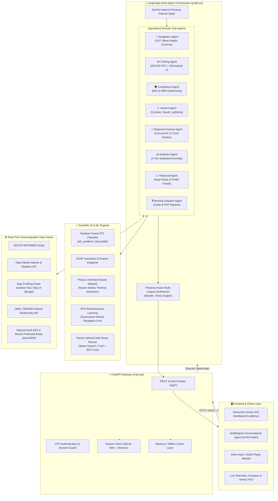

# 🌊 Sagar Mitra 2.0 (ORCA)
### *Autonomous Multi-Agent Geospatial Reasoning & Ocean Biosphere Synthesis Platform*

[](https://fastapi.tiangolo.com/)
[](https://www.python.org/)
[](https://www.langchain.com/langgraph)
[](https://ai.google.dev/)
[](https://leafletjs.com/)
[](https://pytorch.org/)
[](LICENSE)

---

## 📌 Executive Summary

**Sagar Mitra 2.0 (ORCA — Ocean Reasoning & Cognitive Advisory)** is a full-stack, enterprise-grade maritime decision-support platform designed for India's coastal ecosystem. It empowers **artisanal and commercial fisherfolk, marine researchers, port officials, and maritime security authorities** with real-time oceanographic intelligence, predictive analytics, and proactive safety sentry services.

India's 7,516 km coastline supports over 4 million fisherfolk and critical maritime commerce. However, coastal actors face hazardous sea conditions, unpredictable weather shocks, restricted marine zones (MPAs / EEZ borders), and scattered scientific data streams. **Sagar Mitra 2.0 bridges this gap** by unifying live oceanographic feeds (INCOIS, Argo floats, Open-Meteo, OBIS/INDOBIS) into an autonomous **LangGraph multi-agent orchestration architecture**, coupled with **Physics-Informed Neural Networks (PINN)**, **PPO Reinforcement Learning**, and **Explainable AI (SHAP)**.

---

## 🏗️ System Architecture

Sagar Mitra 2.0 is built on an asynchronous, multi-agent cognitive architecture. User queries (text, voice, or telemetry events) are ingested by FastAPI, decomposed into discrete domain goals by a Gemini planner, and executed concurrently across specialized sub-agents.



---

## 🚀 Key Features & Capabilities

### 1. 🤖 LangGraph Multi-Agent Cognitive Pipeline
- **Adaptive Planning**: Uses Google Gemini to dynamically parse compound intent, detect regional dialects (Marathi, Hindi, English), and select minimal optimal sub-agent sets.
- **Strict Anti-Hallucination Grounding**: Compliance sub-agent evaluates vessels against exact `Shapely` polygon coordinates for India's Exclusive Economic Zone (EEZ) and Marine Protected Areas (MPAs). It never fabricates penalties or distances.
- **Concurrent Regional Exploration**: Scans up to 12 coastal zones simultaneously, evaluating chlorophyll-a, sea surface temperature (SST), and wave regimes, ranked using a trained Random Forest classifier.

### 2. 🧠 Scientific Machine Learning & Explainable AI (XAI)
- **PFZ Predictor**: Supervised classification model trained on satellite ocean data to estimate potential fishing zones with high confidence metrics.
- **Interactive SHAP Sensitivity Engine**: Transparent machine learning interface displaying feature attributions (chlorophyll gradients, thermal fronts, bathymetric contours) with dynamic sliders.
- **Physics-Informed Neural Network (PINN)**: Embeds Navier-Stokes fluid dynamics and thermal advection-diffusion PDEs into neural loss functions for deep subsurface temperature and salinity estimation.
- **PPO Reinforcement Learning**: Proximal Policy Optimization agent operating in a custom Gymnasium marine environment (`marine_env.py`) for energy-efficient, wave-avoidant autonomous navigation.

### 3. 🚨 Real-Time Coastal Safety & Sentry Services
- **Anchor Drift Sentry**: Real-time geodesic monitoring of anchored vessels with proactive alarms if position drifts beyond safe radius tolerances.
- **Geofence Guardian**: Precise distance-to-boundary metrics alerting boats approaching international maritime boundary lines or restricted ecologically sensitive zones.
- **SOS & Authority Escalation**: Instant distress incident reporting with automatic telemetry capture and authority notification dispatch.
- **Domain-Filtered Maritime News Feed**: Categorized aggregation of port advisories, coastal security bulletins, and oceanographic research updates.

### 4. 🎙️ Multilingual Voice & Automated Maritime Dispatch
- **Regional Speech Recognition & Synthesis**: Native voice capture, transcription, and TTS response generation tailored for coastal fishermen.
- **Daily Automated PDF Maritime Briefing**: Automated generation of morning operational advisories formatted into professional, downloadable PDF dossiers (`reportlab`).

### 5. 🗺️ High-Resolution Marine GIS Dashboard
- **Interactive Leaflet Visualization**: Seamless toggling between satellite, dark nautical, and oceanic bathymetry basemaps.
- **Living Ocean Layers**: Live Argo float profile markers, OBIS marine biodiversity sightings (turtles, dugongs, yellowfin tuna, oil sardines), thermal contours, and real-time compass HUD.

---

## 💻 Tech Stack

| Domain | Technology / Library | Purpose |
| :--- | :--- | :--- |
| **Backend Framework** | **FastAPI**, **Uvicorn** | High-performance asynchronous REST API gateway |
| **Agentic Framework** | **LangGraph**, **LangChain Core** | Stateful cyclic multi-agent graph orchestration |
| **Large Language Models**| **Google Gemini (1.5 Pro / Flash)** | Intent parsing, reasoning, and multilingual advisory synthesis |
| **Reinforcement Learning** | **Gymnasium**, **Stable-Baselines3 (PPO)**, **TensorBoard** | Marine navigation optimization & telemetry tracking |
| **Deep Learning & PINN** | **PyTorch** | Physics-Informed Neural Network for thermal diffusion PDEs |
| **Classical ML & XAI** | **Scikit-learn**, **XGBoost**, **SHAP**, **Joblib** | PFZ prediction, sensitivity curves, and feature attribution |
| **Geospatial & Ocean** | **Shapely**, **GeoPandas**, **GSW (TEOS-10)**, **PyArrow** | Geofencing, EEZ containment, thermodynamic seawater properties |
| **Data Visualization** | **Matplotlib**, **ReportLab** | Server-side oceanographic charting and PDF report generation |
| **Frontend UI** | **Vanilla ES6+ JS**, **HTML5**, **CSS3 (Glassmorphism)** | Responsive, zero-dependency high-speed client interface |
| **Mapping Engine** | **Leaflet.js** | Multi-layer interactive marine GIS and vessel tracking |
| **Database & Cache** | **SQLite (WAL Mode)**, **In-Memory Cache** | Session state persistence and offline fallback buffering |
| **Deployment** | **Render (Backend)**, **Vercel (Frontend)** | Scalable cloud hosting architecture |

---

## 📂 Project Directory Structure

```plaintext
sagar-mitra-2.0/
├── render.yaml                          # Render cloud blueprint (1-click deployment)
├── vercel.json                          # Vercel frontend routing & rewrites configuration
├── .python-version                      # Pinned Python version (3.11.9)
├── index.html                           # Root entry redirect for Vercel deployment
├── dossier_v2.html                      # Technical platform audit and evaluation dossier
├── Sagar_Mitra_Demo_Script.pdf          # Detailed demonstration walkthrough & script
├── data/                                # Persistent SQLite storage
│   ├── sagar_mitra.db                   # Main application relational database
│   └── sagar_mitra_store.db             # Workspace sessions, memory, and sentry database
└── Sagar-mitra/
    ├── backend/                         # FastAPI & LangGraph backend service
    │   ├── requirements.txt             # Backend Python dependencies
    │   ├── .env.example                 # Environment variables template
    │   ├── users.json                   # Authentication and role configuration
    │   ├── app/                         # Core backend application modules
    │   │   ├── main.py                  # FastAPI server entry point & REST endpoints
    │   │   ├── graph.py                 # LangGraph multi-agent StateGraph definition
    │   │   ├── planner.py               # Gemini-powered query decomposition & agent planner
    │   │   ├── sub_agents.py            # Specialized domain agent nodes
    │   │   ├── advisory.py              # LLM advisory synthesis & grounding formatter
    │   │   ├── state.py                 # Typed shared agent state definition
    │   │   ├── boundary_toool.py        # EEZ & MPA geospatial polygon containment
    │   │   ├── marine_weather_tool.py   # Live wave height, SST, and meteorological retrieval
    │   │   ├── pfz_tool.py              # INCOIS Potential Fishing Zone extractor
    │   │   ├── pfz_ml.py                # Thread-safe Random Forest PFZ classifier
    │   │   ├── chlorophyll_tool.py      # Satellite chlorophyll-a concentration extractor
    │   │   ├── weather_alert_tool.py    # Cyclone, thunderstorm, and squall risk analyzer
    │   │   ├── pareto_xai_planner.py    # Multi-objective Pareto route optimization
    │   │   ├── pinn_ocean_model.py      # Physics-Informed Neural Network (PDE solver)
    │   │   ├── marine_env.py            # Gymnasium environment for maritime RL
    │   │   ├── route_planner.py         # Wave and MPA-aware safe path generator
    │   │   ├── regional_scan.py         # Parallel multi-zone coastal scanner
    │   │   ├── statistical_engine.py    # 4-tier statistical anomaly detection on Argo floats
    │   │   ├── historical.py            # Argo depth profiling and chart generation
    │   │   ├── dispatch.py              # Morning advisory compilation & PDF generator
    │   │   ├── indobis_service.py       # Marine biodiversity occurrence service
    │   │   ├── anchor_store.py          # Sentry anchor drift coordinate tracking
    │   │   ├── voice.py                 # Speech transcription and audio generation
    │   │   ├── news_feed.py             # Maritime RSS aggregator and classifier
    │   │   ├── session_store.py         # Multi-turn conversational memory store
    │   │   ├── db_store.py              # Workspace and task scheduler database
    │   │   └── blackout_cache.py        # Offline fallback cache for network blackouts
    │   ├── data/                        # Static oceanographic GIS data
    │   │   ├── india_eez.geojson        # India Exclusive Economic Zone boundary
    │   │   └── india_mpas.geojson       # Marine Protected Area boundaries
    │   └── scripts/                     # Model training & preparation utilities
    │       ├── prepare_pfz_dataset.py   # Dataset compilation script for PFZ training
    │       └── train_pfz_model.py       # Random Forest training script
    └── final_frontend/                  # Production-ready ocean dashboard frontend
        ├── index.html                   # Landing portal and feature overview
        ├── main.html                    # Platform home screen and service selection
        ├── map.html                     # Live Leaflet GIS oceanographic dashboard
        ├── chatbot.html                 # Multilingual AI copilot & workspace interface
        ├── about.html                   # Mission, methodology, and technology breakdown
        ├── login.html                   # OTP authentication and user profile portal
        ├── ocean-shared.js              # Global API integration, theme, and HUD manager
        ├── ocean-shared.css             # Unified ocean glassmorphism design system
        ├── marine-observations.js       # INDOBIS biodiversity layer integration
        └── assets/                      # High-resolution logos, diagrams, and species icons
```

---

## ⚙️ Installation & Setup Guide

### Prerequisites
- **Python 3.11+** (recommended: Python 3.11.9)
- **Git**
- Modern web browser (Chrome, Firefox, Safari, or Edge)
- (Optional) Google Gemini API Key or Groq API Key

---

### Step 1: Clone the Repository
```bash
git clone https://github.com/chaitijain593-prog/sagar-mitra-2.0.git
cd sagar-mitra-2.0
```

---

### Step 2: Backend Configuration & Setup

1. **Navigate to the backend directory**:
   ```bash
   cd Sagar-mitra/backend
   ```

2. **Create and activate a virtual environment**:
   - **Linux / macOS**:
     ```bash
     python3 -m venv venv
     source venv/bin/activate
     ```
   - **Windows (PowerShell)**:
     ```powershell
     python -m venv venv
     .\venv\Scripts\Activate.ps1
     ```

3. **Install dependencies**:
   ```bash
   pip install --upgrade pip
   pip install -r requirements.txt
   ```

4. **Configure Environment Variables**:
   Create a `.env` file from the provided `.env.example`:
   ```bash
   cp .env.example .env
   ```
   Open `.env` and set your credentials:
   ```env
   # LLM Provider Key (Google Gemini or Groq)
   GEMINI_API_KEY="your-gemini-api-key-here"
   GROQ_API_KEY="your-groq-api-key-here"

   # Server Environment
   ENVIRONMENT="development"
   PORT=8000

   # Optional CORS Restrictions (leave empty for local testing)
   # SAGAR_MITRA_ALLOWED_ORIGINS="http://localhost:5500,http://127.0.0.1:5500"
   ```
   > **Note**: Even without an external API key, Sagar Mitra 2.0 automatically activates an intelligent deterministic fallback synthesizer with full multilingual support, ensuring continuous offline resilience.

5. **Start the FastAPI Server**:
   ```bash
   uvicorn app.main:app --reload --host 0.0.0.0 --port 8000
   ```
   The backend will start at `http://localhost:8000`. Verify health:
   ```bash
   curl http://localhost:8000/api/health
   ```
   API Swagger Docs will be available at `http://localhost:8000/docs`.

---

### Step 3: Frontend Setup

The frontend is built with high-performance vanilla web standards and can be served using any static HTTP server:

1. **Using Python**:
   ```bash
   # From the project root:
   cd Sagar-mitra/final_frontend
   python -m http.server 5500
   ```
2. **Open in Browser**:
   Navigate to:
   - **GIS Ocean Map**: [http://localhost:5500/map.html](http://localhost:5500/map.html)
   - **AI Chatbot**: [http://localhost:5500/chatbot.html](http://localhost:5500/chatbot.html)
   - **Home Portal**: [http://localhost:5500/index.html](http://localhost:5500/index.html)

> **Cloud API Note**: To connect your local frontend to a remote backend (e.g. Render), set `SAGAR_BACKEND_URL` in `localStorage` or environment:
> ```javascript
> localStorage.setItem('SAGAR_BACKEND_URL', 'https://sagar-mitra-backend.onrender.com');
> ```

---

## 📡 API Reference Overview

| Endpoint | Method | Description |
| :--- | :---: | :--- |
| `/api/health` | `GET` | System health check and uptime probe |
| `/api/orchestrate` | `POST` | Core LangGraph multi-agent query execution and synthesis |
| `/api/geofence-check` | `GET` | Instant Point-in-Polygon check against India EEZ and MPAs |
| `/api/route/plan_pareto`| `POST` | Pareto-optimal safe route calculation with hazard avoidance |
| `/api/predict/sensitivity` | `POST` | SHAP feature sensitivity explanation for fishing zone predictions |
| `/api/sentry/anchor-drift` | `POST` | Initialize anchor sentry coordinate tracking for a vessel |
| `/api/sentry/anchor-drift/check` | `GET` | Query real-time anchor drift metrics and breach alerts |
| `/api/sos` | `POST` | Transmit emergency maritime SOS beacon with location |
| `/api/dispatch/generate` | `POST` | Synthesize daily morning advisory, audio brief, and PDF report |
| `/api/voice/orchestrate` | `POST` | Transcribe speech audio, execute agents, and synthesize voice response |
| `/api/marine-observations`| `GET` | Fetch OBIS / INDOBIS marine biodiversity sightings |
| `/api/ecosystem-layers` | `GET` | Fetch GIS layers (SST, chlorophyll, bathymetry, Argo floats) |
| `/api/news` | `GET` | Retrieve categorized maritime, weather, and security news feed |
| `/api/workspaces` | `GET/POST` | Manage user chat sessions, bookmarks, and saved dives |
| `/api/schedule` | `POST` | Schedule recurring maritime tasks, alerts, or queries |

---

## 🧪 Training & Machine Learning Workflows

### Train the Potential Fishing Zone (PFZ) Model
```bash
cd Sagar-mitra/backend
python scripts/prepare_pfz_dataset.py
python scripts/train_pfz_model.py
```
This updates `app/pfz_predictor_best.joblib` with cross-validated accuracy metrics and feature scalers.

### Train the Physics-Informed Neural Network (PINN)
```bash
python app/train_pinn.py
```
Solves Navier-Stokes and thermal advection PDEs across ocean depth intervals and exports `models/pinn_ocean_model.pth`.

### Train Pareto Multi-Objective Route Planner
```bash
python app/train_pareto_xai.py
```

### Reinforcement Learning (PPO) Navigation Policy
```bash
python app/train.py
```
To visualize agent reward convergence across sea-state epochs in TensorBoard:
```bash
tensorboard --logdir app/ppo_marine_tensorboard
```

---

## ☁️ Deployment Guide

### Deploy Backend to Render
A declarative [`render.yaml`](render.yaml) blueprint is included for 1-click cloud deployments:
1. Link this repository to your **Render** account.
2. Select **New Blueprint Instance**.
3. Render will automatically build `Sagar-mitra/backend` on Python 3.11.9 and launch with `uvicorn app.main:app --host 0.0.0.0 --port $PORT`.
4. Inject your `GEMINI_API_KEY` under the service environment variables.

### Deploy Frontend to Vercel
A root [`vercel.json`](vercel.json) is pre-configured with rewrites directing traffic to `Sagar-mitra/final_frontend`:
1. Import the repository into **Vercel**.
2. Deploy directly with default settings.
3. The live frontend will automatically communicate with the deployed Render backend.

---

## 📄 License

This project is licensed under the **MIT License** — see the [LICENSE](LICENSE) file for full details.

---

## 🤝 Acknowledgements & Data Attribution

Sagar Mitra 2.0 builds upon open scientific research, satellite telemetry, and public oceanographic infrastructure:
- **INCOIS (Indian National Centre for Ocean Information Services)** for operational PFZ advisories and Ocean State Forecasts (OSF).
- **Argo Global Array of Profiling Floats** for deep-ocean vertical salinity and temperature profiles.
- **OBIS (Ocean Biodiversity Information System)** & **INDOBIS** for marine species occurrence datasets.
- **Open-Meteo Marine API** for high-resolution meteorological, wave, and swell forecasts.
- **Natural Earth & Marine Regions** for maritime boundaries, EEZ demarcations, and Marine Protected Area shapefiles.

---

<div align="center">
  <b>Sagar Mitra 2.0 · Empowering Indian Coastal Communities with Intelligent Ocean AI</b>
</div>
